<h3 align="center">Hanya seorang hamba Tuhan</h3>

<h3 align="left">Languages and Tools:</h3>

         

<picture data-importer="pacman">
  <source media="(prefers-color-scheme: dark)" srcset="https://raw.githubusercontent.com/LilKalem/LilKalem/pacman-output/pacman-contribution-graph-dark.svg?game=pacman">
  <source media="(prefers-color-scheme: light)" srcset="https://raw.githubusercontent.com/LilKalem/LilKalem/pacman-output/pacman-contribution-graph.svg?game=pacman">
  
</picture>

###
