<pre><picture><source media="(max-width: 1000px)" srcset="Assets/terminal/terminal-top-compact.svg" /></picture>
<a href="https://github.com/LilKalem"><picture><source media="(max-width: 1000px)" srcset="Assets/terminal/terminal-link-github-compact.svg" /></picture></a><a href="https://github.com/LilKalem/BookIfy"><picture><source media="(max-width: 1000px)" srcset="Assets/terminal/terminal-link-bookify-compact.svg" /></picture></a><a href="https://github.com/LilKalem/kepegawaian"><picture><source media="(max-width: 1000px)" srcset="Assets/terminal/terminal-link-kepegawaian-compact.svg" /></picture></a><a href="https://github.com/LilKalem?tab=repositories"><picture><source media="(max-width: 1000px)" srcset="Assets/terminal/terminal-link-repos-compact.svg" /></picture></a>
<picture><source media="(max-width: 1000px)" srcset="Assets/terminal/terminal-fetch-compact.svg" /></picture>
</pre>

---

| Metrics                                                                                                                                                                                                                                                      | Stats                                                                                                                                                                                                                                                                                                                                                                   |
| :----------------------------------------------------------------------------------------------------------------------------------------------------------------------------------------------------------------------------------------------------------- | :---------------------------------------------------------------------------------------------------------------------------------------------------------------------------------------------------------------------------------------------------------------------------------------------------------------------------------------------------------------------- |
|  |   |

---

<picture data-importer="pacman">
  <source media="(prefers-color-scheme: dark)" srcset="https://raw.githubusercontent.com/LilKalem/LilKalem/pacman-output/pacman-contribution-graph-dark.svg?game=pacman">
  <source media="(prefers-color-scheme: light)" srcset="https://raw.githubusercontent.com/LilKalem/LilKalem/pacman-output/pacman-contribution-graph.svg?game=pacman">
  
</picture>

---

  <picture>
    <source media="(max-width: 600px)" srcset="Assets/profile/toolbox-footer-mobile.svg" />
    
  </picture>

